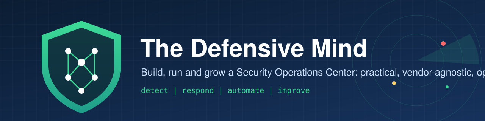

<p align="center">
  
</p>

<p align="center">
  <b>How SOC work is really done, for L1, L2, L3 analysts and SOC managers.</b><br>
  Practical, vendor-agnostic and open. Less theory, more doing.
</p>

<p align="center">
  <a href="https://alnomanbd.github.io/The-Defensive-Mind/"></a>
  
  
  
</p>

<p align="center">
  <a href="LICENSE"></a>
  <a href="LICENSE-CODE"></a>
  <a href="https://github.com/alnomanbd/The-Defensive-Mind/actions"></a>
  
</p>

---

## Why this exists

Most SOC material explains *what* a SOC is. Very little shows **what an analyst actually does at 09:00 with a queue of 40 alerts**, which query answers "did this login succeed?", or how a manager turns a messy month into a one-page report. This handbook is built from hands-on SOC work and written to be used during the shift, not only read before it.

- 🧭 **Role-based field guide**, a real day for L1, L2, L3 and the SOC manager
- 🔎 **Case walkthroughs**, alert -> triage -> investigation -> containment -> lessons, with sample logs and queries
- 🧾 **Copy-paste queries**, the same question in Splunk SPL, Microsoft KQL, Elastic/OpenSearch, IBM QRadar AQL and Wazuh
- 🛡️ **Playbooks** mapped to MITRE ATT&CK, with who-does-what at each tier
- 🎯 **Detection engineering**, Sigma rules, testing, tuning, coverage
- 🤖 **Automation** that reduces work instead of adding noise
- 🕵️ **Dark-web and attack-surface monitoring** with free sources
- 📝 **Policies and templates** ready to adapt for any organisation

## Start here

> **Status: v0.1 preview.** The handbook is growing section by section. Anything marked *coming soon* is being written; see the [roadmap](ROADMAP.md).

| If you are... | Start with |
|:---|:---|
| 🟢 **New / L1 analyst** | [L1 analyst field guide](docs/field-guide/l1-analyst.md) -> [Alert triage](docs/02-daily-operations/alert-triage.md) -> [Investigation cheat sheet](docs/field-guide/investigation-cheatsheet.md) *(coming soon)* |
| 🟡 **L2 / incident handler** | [L2 field guide](docs/field-guide/l2-analyst.md) -> [Playbooks](docs/04-playbooks/index.md) -> [Case walkthroughs](docs/field-guide/walkthroughs/index.md) *(coming soon)* |
| 🔴 **L3 / hunter / detection engineer** *(coming soon)* | [L3 field guide](docs/field-guide/l3-analyst.md) -> [Detection engineering](docs/05-detection-engineering/index.md) -> [Threat hunting](docs/02-daily-operations/threat-hunting.md) |
| 🧑‍💼 **SOC manager / lead** *(coming soon)* | [Manager field guide](docs/field-guide/soc-manager.md) -> [Metrics and KPIs](docs/02-daily-operations/metrics-and-kpis.md) -> [Monthly report template](docs/09-templates/monthly-soc-report.md) |
| 🏗️ **Building a SOC from zero** | [Roadmap](docs/01-build-a-soc/roadmap.md) -> [Technology stack](docs/01-build-a-soc/technology-stack.md) -> [Open-source SOC lab](docs/10-labs-and-tools/open-source-soc-lab.md) |

## What's inside

| Section | What you get |
|:---|:---|
| [00, Start Here](docs/00-start-here/index.md) | What a SOC does, how to use this handbook, career paths, glossary |
| [Field Guide](docs/field-guide/index.md) | L1 and L2 field guides; L3, manager, cheat sheet and 6 case walkthroughs *(coming soon)* |
| [01, Build a SOC](docs/01-build-a-soc/index.md) | 12-month roadmap, operating model, team sizing, stack, log sources, use cases, maturity, budget |
| [02, Daily Operations](docs/02-daily-operations/index.md) | Routines, triage, severity and SLA, handover, case management, tuning, KPIs, hunting with osquery and YARA |
| [03, Incident Response](docs/03-incident-response/index.md) | Lifecycle, classification, escalation and legal clocks, evidence and chain of custody, post-incident review, tabletop and purple team exercises |
| [04, Playbooks](docs/04-playbooks/index.md) | Phishing, BEC, account compromise, brute force, dark-web credential leak, malware and infostealer, ransomware, web attack, data exfiltration, insider threat, DDoS, cloud account compromise |
| [05, Detection Engineering](docs/05-detection-engineering/index.md) | Lifecycle, writing detections, Sigma primer, rule library, testing and tuning, ATT&CK coverage mapping |
| [06, Threat Intelligence](docs/06-threat-intelligence/index.md) | TI lifecycle, dark-web and credential monitoring, external attack surface, IOC management |
| [07, Automation (SOAR)](docs/07-automation-soar/index.md) | What to automate, recipe catalogue, alert fatigue control, case deduplication *(coming soon)* |
| [08, Security Policies](docs/08-security-policies/index.md) | Policy framework, password and MFA, acceptable use, access control, reporting, employee guide |
| [09, Templates](docs/09-templates/index.md) | Incident report, post-incident review, shift handover, monthly report, requests, risk acceptance |
| [10, Labs and Tools](docs/10-labs-and-tools/index.md) | Open-source SOC lab, tool selection, curated resources *(coming soon)* |
| [SOC Document Kit](docs/soc-kit/index.md) | Editable Word SOPs, playbooks, governance documents, forms and reports; 33 published, 152 planned |
| [SOC Training](docs/training/index.md) | Separate training track T01 to T15: SIEM incl. QRadar, endpoint security (EDR, XDR, UEBA), threat intel, hunting, DFIR and more *(coming soon)* |

## Read it as a website

The handbook is published with [MkDocs Material](https://squidfunk.github.io/mkdocs-material/) at
**https://alnomanbd.github.io/The-Defensive-Mind/**, with search, dark mode and copy buttons on every query.

Run it locally:

```bash
pip install -r requirements-docs.txt
mkdocs serve        # open http://127.0.0.1:8000
```

## Use it in your organisation

Everything is written to be adapted: replace the example names (`ACME`, `example.com`), adjust thresholds to your environment, and keep the parts you need. Attribution is all that's required (see licenses below).

## Roadmap

This handbook grows continuously, see [ROADMAP.md](ROADMAP.md) for what is coming next and [CHANGELOG.md](CHANGELOG.md) for what changed.

## Contributing

Corrections, new playbooks, queries for more platforms and real-world tips are welcome. Read [CONTRIBUTING.md](CONTRIBUTING.md) and the [style guide](STYLE_GUIDE.md) first.

## License

- **Content** (documentation, playbooks, templates): [Creative Commons Attribution 4.0 International (CC BY 4.0)](LICENSE)
- **Code and detection rules**: [MIT](LICENSE-CODE)

Use it, share it, adapt it, please credit **"The Defensive Mind, Abdullah Al Noman Patwary"** with a link to this repository.

## Author

**Abdullah Al Noman Patwary**, Senior Cyber Security Engineer (SOC / DevSecOps).
Built from hands-on experience running a production SOC.

> ⭐ If this handbook helps you, star the repository so others can find it.
