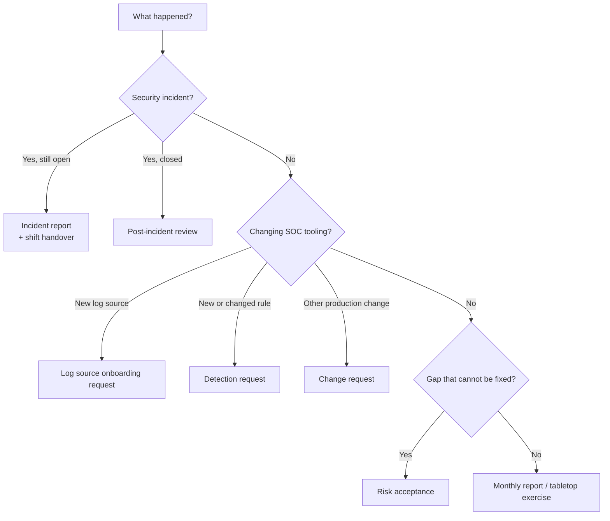

# Templates

Ready-to-copy templates for the documents a Security Operations Center (SOC) writes again and again. Use them as a starting point, then adapt the fields to your own tools and processes.

!!! abstract "At a glance"
    - Audience: SOC analyst / SOC lead / manager
    - Time to read: 5 minutes
    - Outcome: you know which template to use for each situation and how to adapt it

## How to use these templates

1. Copy the template into your ticketing system, wiki or document store.
2. Replace every placeholder in angle brackets, for example `<incident ID>`.
3. Delete sections that do not apply, but write "N/A" with a reason rather than leaving a gap that a reviewer may misread.
4. Keep the filled-in copy with the case or change record so it becomes evidence for audits.

!!! tip "Make them yours"
    A template that matches your tools gets used. Add your own severity names, ticket fields and approval roles once, then reuse that version everywhere.

## Template catalogue

| Template | Use it when | Typical owner | Typical audience |
|---|---|---|---|
| [Incident report](incident-report.md) | A confirmed security incident needs a formal written record | Incident handler | SOC lead, management, auditors |
| [Post-incident review](post-incident-review-template.md) | An incident is closed and you want to learn from it | SOC lead | Everyone involved, process owners |
| [Shift handover](shift-handover-template.md) | One shift hands open work to the next | Outgoing analyst | Incoming analyst, shift lead |
| [Monthly SOC report](monthly-soc-report.md) | You report SOC performance and risk to management | SOC manager | Leadership, CISO, risk committee |
| [Detection request](detection-request.md) | Someone needs a new or changed detection rule | Requester | Detection engineering |
| [Risk acceptance](risk-acceptance.md) | A security gap cannot be fixed now and the business owns the risk | Risk owner | CISO, risk register, auditors |
| [Tabletop exercise](tabletop-exercise-template.md) | You plan and run a discussion-based incident drill | Exercise lead | Responders, management |
| [Log source onboarding request](log-source-onboarding-request.md) | A new system must send logs to the SIEM | System owner | SIEM engineering, SOC lead |
| [Change request](change-request.md) | You change SOC tooling, rules or integrations in production | Engineer | Change approver, SOC lead |

## Which template do I need?

## Common fields across templates

Using the same field names in every template makes search and reporting much easier.

| Field | Format | Example |
|---|---|---|
| Record ID | `<TYPE>-<YYYY>-<NNNN>` | `INC-2026-0042` |
| Date and time | ISO 8601 with time zone | `2026-03-14 09:30 UTC` |
| Severity | Your organisation's scale | Critical / High / Medium / Low |
| Classification | Traffic Light Protocol (TLP) label | TLP:AMBER |
| Owner | Role and name | SOC lead, `<name>` |
| Status | Fixed list of values | Draft / In review / Approved / Closed |

!!! warning "Classification matters"
    Incident reports and post-incident reviews often contain sensitive details such as user names, internal hosts and weaknesses. Label every document and store it with restricted access.

## Checklist

- [ ] Templates copied into your own document or ticketing system
- [ ] Severity scale and roles adjusted to your organisation
- [ ] Record ID format agreed and used everywhere
- [ ] Storage location and access rights defined for each template
- [ ] Templates reviewed at least once a year

## Related pages

- [Playbook template](../04-playbooks/playbook-template.md)
- [Labs and tools](../10-labs-and-tools/index.md)
- [Tool selection guide](../10-labs-and-tools/tool-selection-guide.md)
