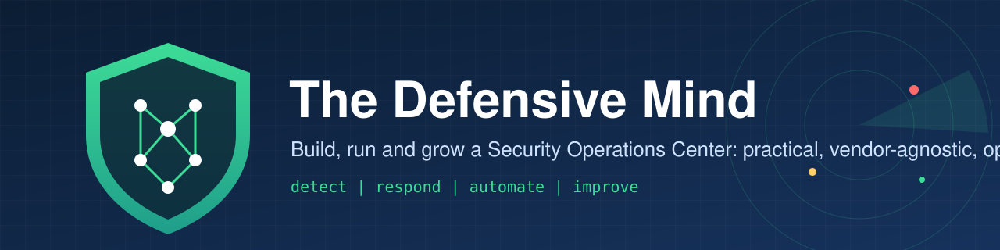

---
hide:
  - navigation
---

# The Defensive Mind

**How SOC work is really done, for L1, L2, L3 analysts and SOC managers.**
Practical, vendor-agnostic and open. Less theory, more doing.

!!! info "v0.1 preview"
    The handbook is growing section by section. Pages marked *coming soon* are being written; see the [roadmap](https://github.com/alnomanbd/The-Defensive-Mind/blob/main/ROADMAP.md).

## Find your path

-   :material-account-search: **L1 analyst**

    ---

    Work the alert queue with confidence: triage the 10 most common alerts, write good notes, escalate at the right time.

    [:octicons-arrow-right-24: L1 field guide](field-guide/l1-analyst.md)

-   :material-shield-search: **L2 / incident handler**

    ---

    Scope, contain and close real incidents, with timelines, approvals and clear communication.

    [:octicons-arrow-right-24: L2 field guide](field-guide/l2-analyst.md)

-   :material-target-account: **L3 / hunter / detection engineer**

    ---

    Hunt, write and tune detections end to end, and test them with adversary emulation.

    [:octicons-arrow-right-24: L3 field guide](field-guide/l3-analyst.md) *(coming soon)*

-   :material-account-tie: **SOC manager**

    ---

    Run the day, the week and the month: SLAs, metrics, staffing, major incidents and management reporting.

    [:octicons-arrow-right-24: Manager field guide](field-guide/soc-manager.md) *(coming soon)*

## Most used pages

| Page | Why people open it |
|:---|:---|
| [Daily routine](02-daily-operations/daily-routine.md) | What to do at the start, middle and end of every shift |
| [Alert triage](02-daily-operations/alert-triage.md) | A repeatable method for every alert |
| [Severity and SLA](02-daily-operations/severity-and-sla.md) | How urgent is this, and who must know? |
| [Playbooks](04-playbooks/index.md) | Step-by-step response for the most common incident types |
| [Dark web and credential monitoring](06-threat-intelligence/dark-web-and-credential-monitoring.md) | Find stolen company logins before attackers use them |

## Building a SOC?

The Build a SOC section (12-month roadmap, technology stack, open-source SOC lab) is *(coming soon)*. Until then, start with [What is a SOC](00-start-here/what-is-a-soc.md) and the [Daily routine](02-daily-operations/daily-routine.md).

---

Content licensed [CC BY 4.0](https://creativecommons.org/licenses/by/4.0/), Code and rules MIT, [Source on GitHub](https://github.com/alnomanbd/The-Defensive-Mind)
